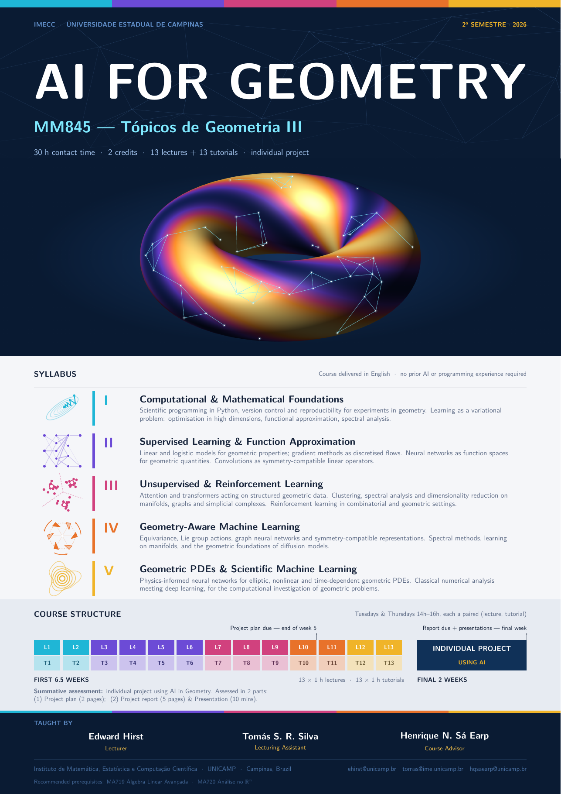

# AI for Geometry

**MM845 — Tópicos de Geometria III**
IMECC · Universidade Estadual de Campinas · 2º semestre 2026

30 h contact time · 2 credits · 13 lectures + 13 tutorials · individual project

No prior AI or programming experience required.

This repository holds the lecture slides and tutorial materials for the course.

- [`slides/`](slides/) — lecture slides and the course poster

**Lectures & tutorials**

- [`lecture_01`](slides/lecture_01.pdf) · [`tutorial_01/`](tutorial_01/) — Coding Foundations: Python, Git, & AI Agents
- [`lecture_02`](slides/lecture_02.pdf) · [`tutorial_02/`](tutorial_02/) — Mathematical Foundations of Machine Learning
- [`lecture_03`](slides/lecture_03.pdf) · [`tutorial_03/`](tutorial_03/) — Linear Models, Optimisation & Regularisation
- [`lecture_04`](slides/lecture_04.pdf) · [`tutorial_04/`](tutorial_04/) — Neural Networks: Theory, Architecture, Training
- [`lecture_05`](slides/lecture_05.pdf) · [`tutorial_05/`](tutorial_05/) — Convolutional Neural Networks
- [`lecture_06`](slides/lecture_06.pdf) · [`tutorial_06/`](tutorial_06/) — Transformers & Attention
- [`lecture_07`](slides/lecture_07.pdf) · [`tutorial_07/`](tutorial_07/) — Unsupervised Learning: Clustering
- [`lecture_08`](slides/lecture_08.pdf) · [`tutorial_08/`](tutorial_08/) — Dimensionality Reduction: PCA, Kernel PCA & Nonlinear Visualisation
- [`lecture_09`](slides/lecture_09.pdf) · [`tutorial_09/`](tutorial_09/) — Introduction to Reinforcement Learning
- [`lecture_10`](slides/lecture_10.pdf) · [`tutorial_10/`](tutorial_10/) — Geometry-Aware ML I: Equivariance & Symmetry
- [`lecture_11`](slides/lecture_11.pdf) · [`tutorial_11/`](tutorial_11/) — Geometry-Aware ML II: Manifolds & Diffusion Models
- [`lecture_12`](slides/lecture_12.pdf) · [`tutorial_12/`](tutorial_12/) — Physics-Informed Neural Networks for Geometry I
- [`lecture_13`](slides/lecture_13.pdf) · [`tutorial_13/`](tutorial_13/) — PINNs for Geometry II & Neural Operators

**Delivered by** Edward Hirst & Tomás S. R. Silva

---

